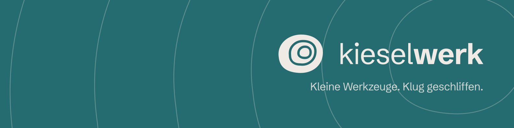

Kieselwerk baut Webseiten, kleine Apps und KI-Lösungen für Selbstständige und kleine Büros. Sorgfältig bis ins Detail und so klar aufgebaut, dass man sie selbst weiterführen kann. Aus Augsburg.

### Projekte

| | |
|---|---|
| **[Mixsmith](https://github.com/Kieselwerk/Mixsmith)** | Mischen und Mastern nach dem Vorbild von Referenzsongs, mit Mischpult, A/B-Vorschau und lokaler KI-Stem-Trennung. Windows, Linux, macOS. Freie Software unter der GPLv3. [Download auf itch.io](https://kieselwerk.itch.io/mixsmith) |

### Kontakt

[info@kieselwerk.com](mailto:info@kieselwerk.com) · [kieselwerk.com](https://kieselwerk.com)
